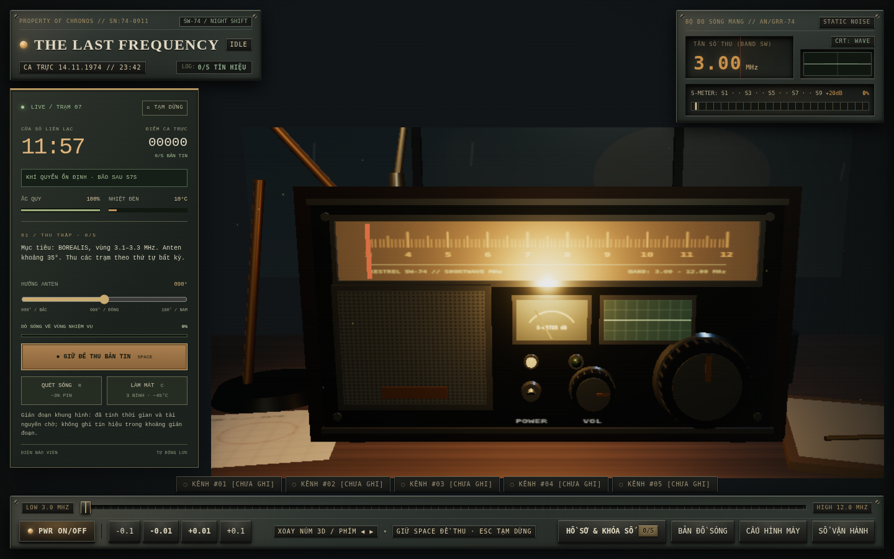
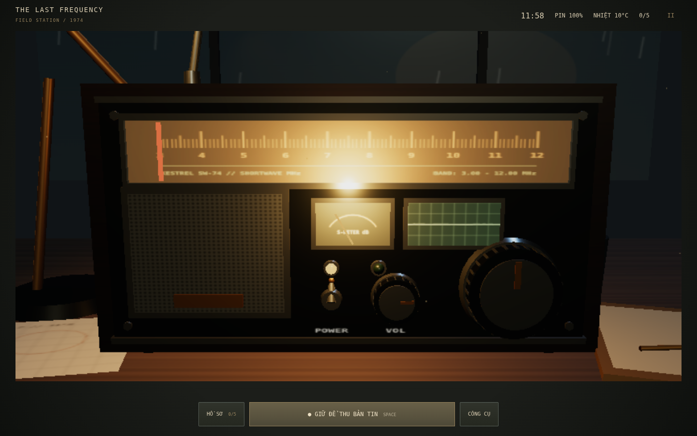
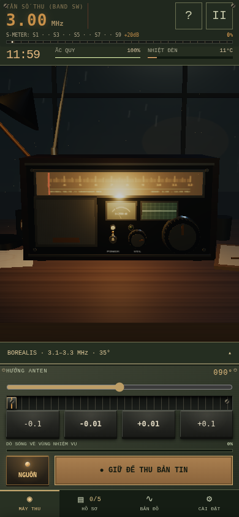
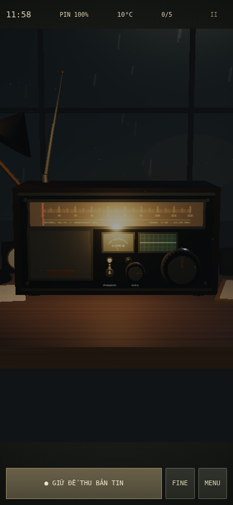

# V4.0 — ảnh từ ứng dụng chạy thật

Baseline: `394bb9387b302c55026cf2d1c2123d198bb5555d` (V3.2). Ảnh `before-*` được chụp **trước khi chỉnh sửa source**. Ảnh `after-*` chụp bản V4 trong cùng môi trường Chromium/SwiftShader, cùng save mới, Low Quality, cùng viewport và DPR 1. Đây là ảnh WebGL thật; không dùng concept, ảnh dựng thay radio hoặc fallback để chứng minh 3D.

| Viewport | V3.2 trước | V4.0 sau |
| --- | --- | --- |
| Desktop 1440×900 | [Ảnh trước](before-1440x900.png) | [Ảnh sau](after-1440x900.png) |
| Desktop 1920×1080 | [Ảnh trước](before-1920x1080.png) | [Ảnh sau](after-1920x1080.png) |
| Mobile 390×844 | [Ảnh trước](before-390x844.png) | [Ảnh sau](after-390x844.png) |
| Mobile 320×568 | [Ảnh trước](before-320x568.png) | [Ảnh sau](after-320x568.png) |
| Landscape 844×390 | [Ảnh trước](before-844x390.png) | [Ảnh sau](after-844x390.png) |

## Desktop




## Mobile




Low Quality vẫn giới hạn buffer 360.000 pixel, vì vậy ảnh desktop có thể mềm hơn High Quality. Ảnh này so sánh bố cục và kích thước radio, không đo FPS hoặc chất lượng GPU thật. Mưa, đồng hồ và đèn có thể ở thời điểm khác nhau.

`before-metrics.json` / `after-metrics.json` ghi vùng canvas CSS và tâm control Three.js được project ra màn hình. Khoảng cách tâm POWER→TUNING dùng làm chỉ dấu cùng một mô hình hiển thị lớn hơn; không coi diện tích canvas là diện tích cabinet.

Tái tạo ảnh sau từ repo đang chạy:

```sh
npm run dev -- --port 5173 --strictPort
# Terminal thứ hai; CHROMIUM_PATH chỉ cần nếu dùng Chromium hệ thống đã xác minh:
CHROMIUM_PATH=/usr/bin/chromium node scripts/capture-visuals.mjs after
```

Không ghi đè ảnh `before` bằng source V4. E2E còn lưu screenshot sau tương tác, fallback, game over và phục hồi WebGL trong `test-results/`; trace/report lỗi ở `playwright-report/` (ignored).

## Hồ sơ và công cụ

[Field Operations](after-field-operations.png) · [Hồ sơ giấy](after-journal.png) · [Ghi chú](after-notes.png)
